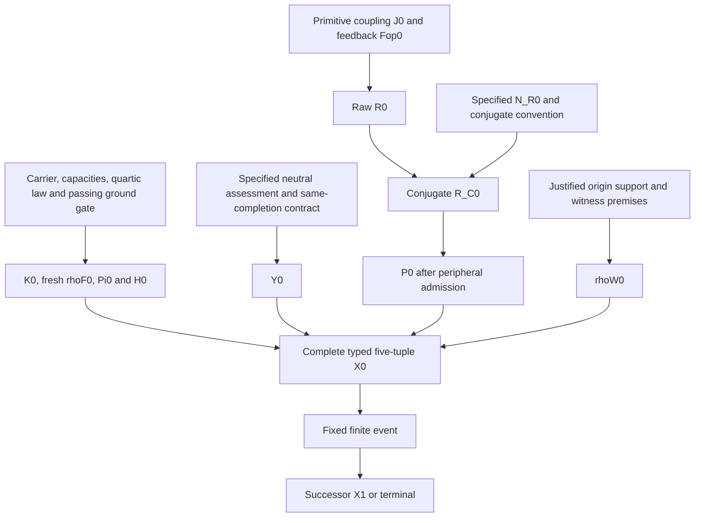

# Origin-to-event dependency closure: consolidated checkpoint

Date: 3 November 2026. This consolidates the existing research record; it is not a new paper, physical law or initializer.

## 1. Decision

**The fixed finite event is closed from its complete typed input. A unique first input has not been derived from the smaller reviewed formation/origin packet.** These are different claims. The prior conditional neutral/Gram derivations and finite-event theorems remain in force; none is invalidated by the missing origin implications.

The exact original-to-origin chain is not completed simply by adding together statements from different historical formulations. Their domains, primitive inputs and declared extensions must remain visible. In particular, scalar feedback, cognitive primitive operators, formed tangent geometry and the November five-tuple are not interchangeable types.

[dependency_graph.json](dependency_graph.json) contains 38 named quantities/premises, 16 guarded inference rules, 9 source records and 8 explicit premise-packet scenarios. Each inference requires **all** listed premises. Source records point to the pinned original manifests and passage anchors from the prior audits, including the 2025 lineage and newly located May 14 PDF. This is an auditable finite dependency model, not an exhaustive axiomatization or a proof-assistant verification of every BFG claim.

## 2. Premise ledger

| Premise group | Actual source/status | What it supplies |
| --- | --- | --- |
| Scalar order and feedback definitions | April 17, 2025 Section 7.2; February 4, 2026 Section 3.3; original consolidated Sections 2–4 | Ratio/product-derivative diagnostics on specified scalar data; no automatic operator-valued map |
| Primitive identity/persistence | June origin paragraphs 101–108; structured Level-0 identity/recurrence clauses | Structural prerequisites, not an already specified projector on the later finite carrier |
| Finite carrier, inner product, capacity triple | September 22 Section 3, paragraphs 68–70 | A typed formation problem and K=c+aleph-D; numerical operators remain supplied data |
| Quartic functional and simple-negative gate | Same source paragraphs 71–80 | Fresh density, ground projector and positive formed Hessian; the gate is a checked condition, not guaranteed for all capacities |
| Specified quadratic neutral completion and role identification | Existing tangent bridge/unified theorem, pinned in the crosswalk | Resolvent and Gram of that same supplied assessment; channel, metrics and identification are real premises |
| Primitive coupling and feedback factors | May 14 original Axiom 2, pp.2–3 | Given factors determine raw R by composition; their origin values are not derived in that axiom |
| Conjugate mediation and peripheral admission | May 16 extension; September 22 Section 5 with the existing peripheral-space repair | Given N_R and R determine R_C; admitted R_C determines persistent support |
| Neural interface equation | May 14 Definition 13, p.5 | Conditional feedback reconstruction from the other instantaneous data if gamma_N!=0; neural-domain applicability is required |
| Origin support/witness identification | Exact conditional lemmas from this audit; no enforcing historical implication established | Would close P/W only if their boundary premises are justified; not adopted |
| Fixed finite event | November Section 12; September 26 minimal state; current master contract | Unique successor class or terminal from supplied K,rhoF,rhoW,Y,P, under its declared selection/transport/Gram/seed rules |

The formation functional is a supplied source law at this level; the scalar order ratio alone has not been shown in the reviewed chain to select the finite carrier, capacity matrices or that functional. Likewise the declared event completion rules are not backdated as theorems forced by the earliest 2025 scalar definitions.

The `finite_contract` node is a named module, not a hidden universal premise. It comprises the specified signed closure gain and strict selection boundary; polar overlap/kernel convention; density transport and witness conditioning; G-metric projection and formation-weighted loads; reciprocal equal-weighted-load prescription and normalization; ambient two-channel stacking; common direct-sum kernel transport; intrinsic-Gram identification in matched active coordinates; R4 inherited transport; the simple-negative seed on exactly the emergent complement; persistent-sector promotion; and exact absorbing terminal policy. The [19-step source/program crosswalk](../foundation_audit/DERIVATION_PROGRAM_CROSSWALK.md) lists the source anchors and distinguishes the algebra derived inside these clauses from the role/ordering clauses that are stipulated. The dependency checker treats this already specified module as a contract; it does not newly prove all its internal theorems.

## 3. Dependency map

The boundary box is an outstanding premise group, not a proved source implication. Its detailed guarded rules are in the JSON. The graph does not contain an unconditional arrow H0->Y0, Pi0->P0 or Pi0->rhoW0. Its ordinary P is distinct from a graph-metric projector. A successor Y1 is not silently used as initial Y0.

## 4. Closure tests

| Explicit packet supplied | Forward result | What this does not establish |
| --- | --- | --- |
| Formation carrier/capacities/law and passing gate | K0, fresh rhoF0, Pi0, H0 | Y0, P0, rhoW0 and primitive recursion factors do not follow by the recorded rules |
| Complete typed five-tuple plus fixed event | Unique X1, including terminal possibility | Initial J0/Fop0/R0 need not be reconstructed to compute that event |
| Rich supplied interface, factors, N_R, witness and admission | Complete initial finite state and its event | Those supplied values have not thereby been derived from the smaller packet |
| Formation plus interface and explicit least-support/witness boundary premises | Conditional complete finite origin and its event | The added boundary premises are hypothetical, not adopted or proved historical necessities |
| Neural equation and other interface data, but neither Fop0 nor dotN0 | Neither unknown is reconstructed | Rearranging an equation cannot bootstrap both unknown sides |
| Same neural packet with dotN0 independently supplied | Fop0 and then R0 follow | The origin derivative/data and neural-to-origin domain bridge remain inputs |
| Y0 plus a proposed origin reuse of the successor rebuild, but no P0 or R_C0 | Neither P0 nor R_C0 follows | The two equations form a relation, not a uniqueness theorem selecting its solution |
| Scalar paths and original diagnostic definitions | Scalar order/feedback diagnostics | No operator factor or finite origin state follows without a representation bridge |

All packet labels assume compatible mathematical types and domains. Checked gate facts must be established for actual data; simply listing a node is not a numerical certificate. The graph distinguishes a conditional rule from a rule whose guards have actually been supplied.

## 5. Circular derivations and unjustified shortcuts

**Neural inversion loop.** The source equation computes dotN from Fop and other data. Its algebraic inverse computes Fop from dotN and those data when gamma is nonzero. Both implications are valid conditionally. Together they do not identify either unknown without independent data. The checker detects the component `{Fop0,dotN0}` and verifies that closure without either does not seed it.

**Persistence/rebuild loop.** A supplied admissible R_C0 fixes P0. The successor rebuild fixes an R_C from a supplied P and Y. Even if an origin extension of that rebuild were justified, the resulting coupled relation would still need a uniqueness proof. The earlier exact support families show multiple solutions under the stated preservation/boundedness packet. The checker detects `{P0,RC0}` and verifies that no missing initial support appears through circular propagation.

**Temporal substitution.** Y1=A0* A0 in matched active coordinates follows only after the event has used Y0 to construct selection, metric, loads, weights and A0. Identifying Y1 with Y0 would impose a fixed-point/boundary condition absent from the audited premise packet; it is not the original Gram elimination.

**Role substitutions.** N_R=C_N(Y), scalar I_B=Fop, and the formed Hessian H0 as a complete source-neutral assessment are unproved identifications in the reviewed chain. Positivity, shared terminology or a missing numerical coefficient does not supply them.

**Origin identification.** A unique formed-line projector is already derived. The further equalities P0=Pi0 and rhoW0=Pi0 have precise conditional proofs, but their origin support/representation assumptions cannot be erased. Minimality of the five operational roles does not mean minimum rank of P.

The checker records six prohibited shortcuts as unlicensed inferences, rather than installing them. It does not treat every dependency cycle as a contradiction: an evolution equation can legitimately connect quantities mutually. The issue is using that relation as a proof of unique initial data without an independent input or a uniqueness argument.

## 6. What is still supplied or unestablished

There are **obligation groups**, not a proved count of independent fundamental axioms:

1. The carrier, capacity values and formation setup are supplied in the audited finite formation sector; their unique recovery from the earliest scalar/structural statements is not established.
2. The initial joint source-neutral assessment must be specified or derived. Its elimination is already known; H0 alone does not fix its mixed block and intrinsic neutral metric.
3. Origin persistence needs a justified raw/neutral recursion prescription or an equivalent support rule. The cognitive factors can be given as primitives, but their first values are not obtained merely by composing their names. N_R's relationship to the initial neutral response must also be justified if used.
4. Primitive identity needs a source-supported representation as the normalized first witness. The source's inherited continuation alone does not initialize an origin without a predecessor.

One stronger existing premise might settle several groups together. This audit does not prove that a new axiom is logically necessary, or that all possible historical derivations fail. It establishes that the **recorded source-backed implications** have not yet closed those gaps, and that several tempting substitutes do not work.

## 7. Research decision

The completed conditional finite program and its checked algebra should remain usable as such. Unique origin derivation remains an open foundational objective. The honest next work is either an exact source implication filling one of the named gaps or conditional analysis with the supplied data explicitly frozen. Repeating inverse equations, renaming a proposed premise, or generating another convenient initializer is not additional foundational progress.

This checkpoint does not invalidate deterministic evolution, certify all 48 manuscript statements, establish empirical science from the BFG alone, or validate the cognitive manuscript's broader claims. No paper or event helper is changed.

Run `python dependency_closure/check_dependencies.py`. [results.json](results.json) records forward closures, guarded cycles and shortcut checks. The checker verifies dependency bookkeeping and provenance links; it is **not** an independent proof of the theorems attached to the graph edges. Their prior proofs and exact fixtures remain the evidence for those edges.
